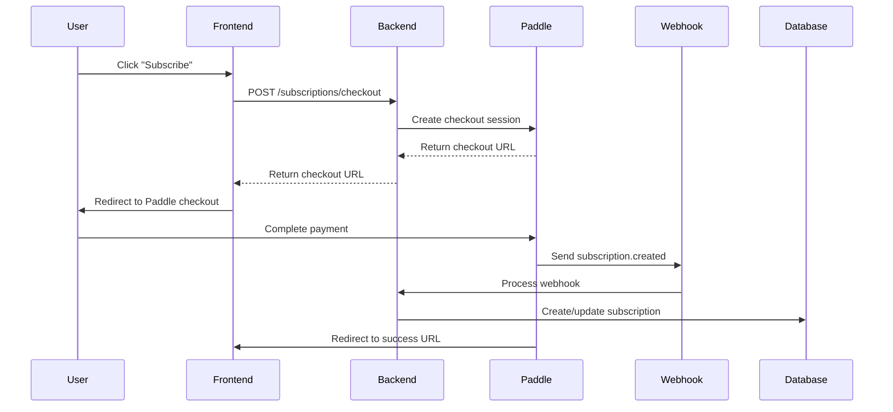

# Paddle Subscription Integration

This document provides a comprehensive guide for implementing Paddle payment gateway for subscriptions in the Jarayid backend application.

## Overview

The Paddle integration provides:
- Subscription management (create, update, cancel)
- Webhook handling for real-time updates
- Premium access middleware
- Checkout URL generation
- Trial period support
- Multiple billing intervals (monthly/yearly/weekly)

## Setup Instructions

### 1. Paddle Account Setup

1. **Create Paddle Account**: Sign up at [paddle.com](https://paddle.com)
2. **Get API Credentials**:
   - Go to Developer Tools → Authentication
   - Generate API Key
   - Copy Webhook Secret from Webhook settings

3. **Create Products & Prices**:
   ```bash
   # Example products
   - Product: "Premium Subscription"
     - Monthly Price: $9.99/month
     - Yearly Price: $99.99/year (save 17%)
   ```

4. **Configure Webhooks**:
   - Webhook URL: `https://your-domain.com/api/subscriptions/webhook`
   - Events to subscribe:
     - subscription.created
     - subscription.updated
     - subscription.cancelled
     - subscription.paused
     - subscription.resumed
     - transaction.completed
     - transaction.payment_failed

### 2. Environment Configuration

Add these variables to your `.env` file:

```env
# Paddle Configuration
PADDLE_API_KEY=your_paddle_api_key_here
PADDLE_WEBHOOK_SECRET=your_paddle_webhook_secret_here
PADDLE_MONTHLY_PRICE_ID=pri_monthly_price_id_here
PADDLE_YEARLY_PRICE_ID=pri_yearly_price_id_here

# Frontend URLs
FRONTEND_URL=https://your-frontend-domain.com
```

### 3. Database Schema

The subscription model includes:

```sql
-- Core subscription fields
id, userId, isPremium, trialEndsAt

-- Paddle integration fields
paddleSubscriptionId, paddleCustomerId, paddlePlanId
status, currentPeriodStart, currentPeriodEnd
cancelAtPeriodEnd, cancelledAt, pausedAt, resumedAt

-- Payment information
currency, amount, interval
lastPaymentAt, nextPaymentAt, failedPaymentCount

-- Metadata
metadata (JSON field for additional data)
```

## API Endpoints

### Authentication Required Endpoints

#### Get Subscription Plans
```http
GET /api/subscriptions/plans
```

**Response:**
```json
{
  "success": true,
  "data": {
    "plans": [
      {
        "id": "monthly_premium",
        "name": "Premium Monthly",
        "priceId": "pri_xxxxx",
        "interval": "MONTHLY",
        "price": 9.99,
        "currency": "USD",
        "features": ["Unlimited articles", "AI summaries", "No ads"]
      }
    ]
  }
}
```

#### Create Checkout URL
```http
POST /api/subscriptions/checkout
Authorization: Bearer <token>

{
  "priceId": "pri_xxxxx",
  "trialDays": 7,
  "successUrl": "https://yoursite.com/success",
  "failureUrl": "https://yoursite.com/failed"
}
```

**Response:**
```json
{
  "success": true,
  "data": {
    "checkoutUrl": "https://checkout.paddle.com/xxx"
  }
}
```

#### Get User Subscription
```http
GET /api/subscriptions/me
Authorization: Bearer <token>
```

**Response:**
```json
{
  "success": true,
  "data": {
    "subscription": {
      "id": "sub_xxxxx",
      "status": "ACTIVE",
      "isPremium": true,
      "currentPeriodEnd": "2025-08-29T00:00:00Z",
      "nextPaymentAt": "2025-08-29T00:00:00Z",
      "amount": 9.99,
      "currency": "USD",
      "interval": "MONTHLY"
    },
    "hasActiveSubscription": true
  }
}
```

#### Cancel Subscription
```http
POST /api/subscriptions/{subscriptionId}/cancel
Authorization: Bearer <token>

{
  "immediate": false
}
```

#### Update Subscription (Change Plan)
```http
PUT /api/subscriptions/{subscriptionId}
Authorization: Bearer <token>

{
  "newPriceId": "pri_new_plan_id"
}
```

### Webhook Endpoint (Public)

#### Handle Paddle Webhooks
```http
POST /api/subscriptions/webhook
Content-Type: application/json
Paddle-Signature: <signature>

{
  "event_type": "subscription.created",
  "data": { ... }
}
```

## Implementation Flow

### 1. User Subscription Flow



### 2. Premium Access Control

Use middleware to protect premium features:

```javascript
// Require active premium subscription
const { requirePremium } = require('../middleware/premium');
router.get('/premium-articles', auth, requirePremium, getArticles);

// Optional premium check (doesn't block access)
const { checkPremiumStatus } = require('../middleware/premium');
router.get('/articles', auth, checkPremiumStatus, getArticles);

// In controller
if (req.isPremium) {
  // Show premium content
} else {
  // Show limited content + upgrade prompt
}
```

### 3. Webhook Security

Implement webhook signature verification:

```javascript
const crypto = require('crypto');

function verifyWebhookSignature(signature, body, secret) {
  const expectedSignature = crypto
    .createHmac('sha256', secret)
    .update(JSON.stringify(body))
    .digest('hex');
  
  return signature === expectedSignature;
}
```

## Service Methods

### PaddleSubscriptionService

#### Key Methods:

1. **createCustomer(userData)**: Create Paddle customer
2. **createSubscription(userId, priceId, options)**: Create subscription
3. **generateCheckoutUrl(priceId, customerData, options)**: Generate checkout
4. **cancelSubscription(subscriptionId, immediate)**: Cancel subscription
5. **getUserSubscription(userId)**: Get user's subscription with sync
6. **handleWebhook(event)**: Process webhook events

#### Usage Examples:

```javascript
const paddleService = require('../services/paddleSubscriptionService');

// Create checkout URL
const checkoutUrl = await paddleService.generateCheckoutUrl(
  'pri_xxxxx',
  { userId: 'user123', email: 'user@example.com' },
  { trialDays: 7 }
);

// Get subscription status
const subscription = await paddleService.getUserSubscription('user123');

// Cancel subscription
await paddleService.cancelSubscription('sub123', false);
```

## Error Handling

Common error scenarios:

1. **Insufficient Permissions**: Return 403 with upgrade prompt
2. **Invalid Subscription**: Return 404 with subscription not found
3. **Payment Failures**: Handle via webhooks, update status
4. **Webhook Verification**: Validate signatures to prevent fraud

## Testing

### Test Scenarios:

1. **Subscription Creation**:
   - Valid price ID → Success
   - Invalid price ID → Error
   - Existing subscription → Error

2. **Webhook Processing**:
   - subscription.created → Create local subscription
   - transaction.completed → Update payment status
   - subscription.cancelled → Update status

3. **Premium Access**:
   - Active subscription → Allow access
   - Expired subscription → Deny access
   - No subscription → Deny access

### Test Environment:

Use Paddle Sandbox for development:
- Set `NODE_ENV=development` for sandbox mode
- Use test payment methods
- Test webhook events using Paddle's webhook simulator

## Security Considerations

1. **Webhook Verification**: Always verify webhook signatures
2. **User Authorization**: Ensure users can only manage their own subscriptions
3. **Data Validation**: Validate all input data
4. **Rate Limiting**: Implement rate limiting on subscription endpoints
5. **Audit Logging**: Log all subscription changes

## Monitoring & Analytics

Track key metrics:

1. **Subscription Metrics**:
   - New subscriptions per day/month
   - Churn rate
   - Revenue tracking
   - Trial conversion rate

2. **Error Monitoring**:
   - Failed webhook processing
   - Payment failures
   - API errors

3. **User Behavior**:
   - Premium feature usage
   - Upgrade funnel analytics

## Frontend Integration

### React Example:

```javascript
// Subscribe component
const handleSubscribe = async (priceId) => {
  try {
    const response = await api.post('/subscriptions/checkout', {
      priceId,
      trialDays: 7
    });
    
    // Redirect to Paddle checkout
    window.location.href = response.data.checkoutUrl;
  } catch (error) {
    console.error('Subscription error:', error);
  }
};

// Check subscription status
const { data: subscription } = await api.get('/subscriptions/me');
if (subscription.hasActiveSubscription) {
  // Show premium features
}
```

## Troubleshooting

### Common Issues:

1. **Webhook Not Receiving Events**:
   - Check webhook URL configuration
   - Verify SSL certificate
   - Check firewall settings

2. **Subscription Status Not Updating**:
   - Verify webhook events are being processed
   - Check database connections
   - Review error logs

3. **Payment Failures**:
   - Check Paddle dashboard for payment details
   - Verify customer payment methods
   - Review failed transaction logs

## Production Deployment

### Pre-deployment Checklist:

- [ ] Update environment variables with production Paddle credentials
- [ ] Configure production webhook URLs
- [ ] Test webhook signature verification
- [ ] Set up monitoring and alerting
- [ ] Configure backup and recovery procedures
- [ ] Test subscription flows end-to-end

### Performance Optimization:

1. **Database Indexing**: Add indexes on subscription queries
2. **Caching**: Cache subscription status for frequent checks
3. **Connection Pooling**: Configure proper database connection limits
4. **Webhook Processing**: Use queues for webhook processing if needed

This integration provides a robust foundation for subscription management using Paddle. The modular design allows for easy customization and extension based on specific business requirements.
